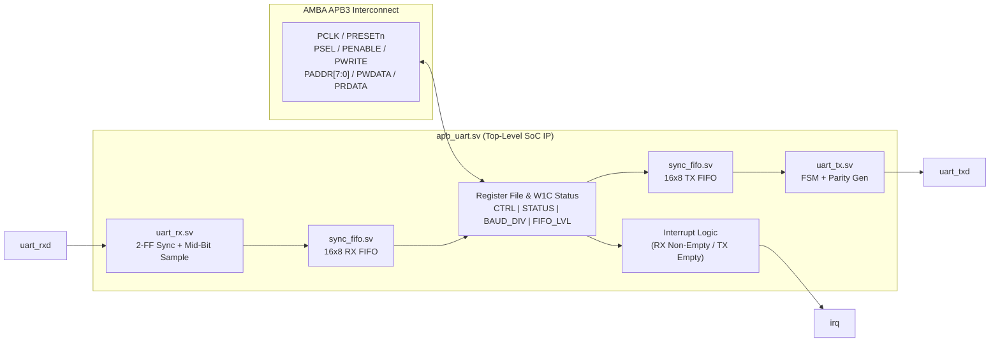

# AMBA APB3 UART SoC Peripheral IP Core (SystemVerilog RTL & Verification)

[](https://github.com/Danhle23/uart-controller/actions/workflows/rtl-ci.yml)


-10B981)

A synthesizable, full-duplex **AMBA APB3 memory-mapped UART peripheral IP core** written in IEEE 1800-2012 SystemVerilog. Designed for microcontroller/SoC integration with **dual 16×8 synchronous TX/RX FIFOs**, **runtime-programmable fractional/integer baud rate generation**, **even/odd hardware parity**, **2-stage CDC metastability synchronization**, **framing/overrun sticky error detection**, and **interrupt generation (`IRQ`)**.

Verified via automated **GitHub Actions EDA CI** running **Verilator `-Wall` static lint** and **Icarus Verilog self-checking BFM testbenches**.

---

## Architecture Overview



---

## Repository Structure

| File | Module / Role | Key Engineering Details |
| :--- | :--- | :--- |
| `apb_uart.sv` | Top-level AMBA APB3 Slave IP | Zero-wait-state APB3 interface, W1C error flags, internal diagnostic loopback, maskable `irq`. |
| `sync_fifo.sv` | Parameterized Circular FIFO | Synthesizable `16×8` TX and RX buffers decoupling CPU bus bursts from serial wire rate. |
| `uart_tx.sv` | Serial Transmitter Engine | Deterministic FSM (`IDLE → START → DATA → PARITY → STOP`), runtime `cfg_clk_div`, even/odd parity. |
| `uart_rx.sv` | Serial Receiver Engine | 2-FF async input synchronizer, false-start glitch rejection, mid-bit sampling, `parity_err` & `framing_err`. |
| `uart_tb.sv` | PHY Layer Testbench | 45+ directed/random frames, 8N1/8E1/8O1 parity checks, parity mismatch & break framing-error injection. |
| `apb_uart_tb.sv` | SoC APB3 BFM Testbench | APB3 `SETUP → ACCESS` bus functional tasks, 12-byte back-to-back FIFO burst streaming, `IRQ` lifecycle checks. |
| `.github/workflows/rtl-ci.yml` | Automated EDA Regression | Runs `verilator --lint-only -Wall` + `iverilog -g2012` testbenches on every push. |

---

## Memory-Mapped Register Specification (`apb_uart`)

All registers are 32-bit word-aligned on the APB3 byte address space:

| Offset | Register | Access | Bitfields & Description |
| :--- | :--- | :--- | :--- |
| `0x00` | `TXDATA` | `WO` | `[7:0]` Push byte into 16-entry TX FIFO when `ctrl.tx_en = 1`. |
| `0x04` | `RXDATA` | `RO` | `[7:0]` Pop oldest received byte from 16-entry RX FIFO. |
| `0x08` | `STATUS` | `RO / W1C` | `[0]` `tx_full`, `[1]` `tx_empty`, `[2]` `rx_full`, `[3]` `rx_empty`, `[4]` `tx_busy`, `[5]` `parity_err (W1C)`, `[6]` `framing_err (W1C)`, `[7]` `rx_overrun (W1C)`. |
| `0x0C` | `CTRL` | `R/W` | `[0]` `tx_en`, `[1]` `rx_en`, `[2]` `parity_en`, `[3]` `parity_odd`, `[4]` `irq_rx_en`, `[5]` `irq_tx_en`, `[6]` `loopback_en`, `[7]` `fifo_clr` (self-clearing). |
| `0x10` | `BAUD_DIV` | `R/W` | `[15:0]` Programmable clock cycles per bit (`PCLK_HZ / BAUD_RATE`). |
| `0x14` | `FIFO_LVL` | `RO` | `[15:8]` Current `rx_fifo` occupancy (`0..16`), `[7:0]` Current `tx_fifo` occupancy (`0..16`). |

---

## Running Simulation & Lint Locally

```bash
# Install open-source SystemVerilog toolchain
# Ubuntu/Debian: sudo apt-get install iverilog verilator gtkwave
# macOS:         brew install icarus-verilog verilator gtkwave

# 1. Static synthesis & width-check lint
verilator --lint-only -Wall --top-module apb_uart sync_fifo.sv uart_tx.sv uart_rx.sv apb_uart.sv

# 2. Run full PHY + AMBA APB3 SoC regression suite
make sim
```

---

## Author

**Lê Thanh Danh** — Electronics & Telecommunications Engineering, VNUHCM - University of Science  
GitHub: [@Danhle23](https://github.com/Danhle23) · Email: [danhle2305@gmail.com](mailto:danhle2305@gmail.com)
